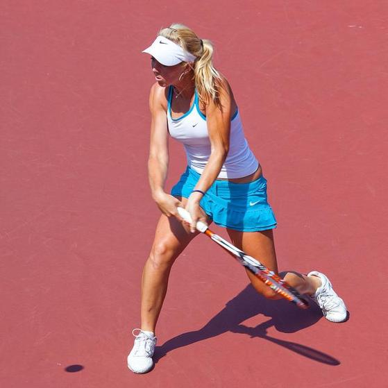
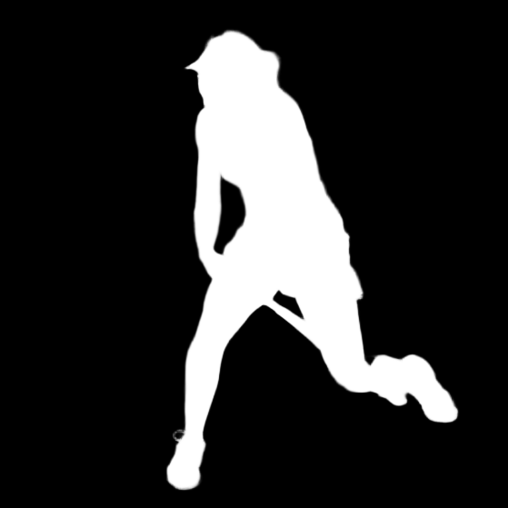
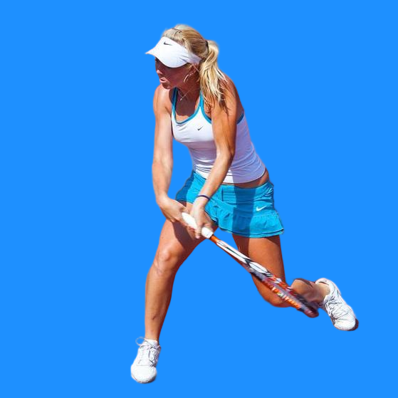
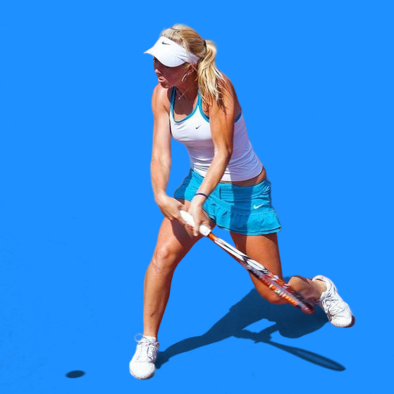
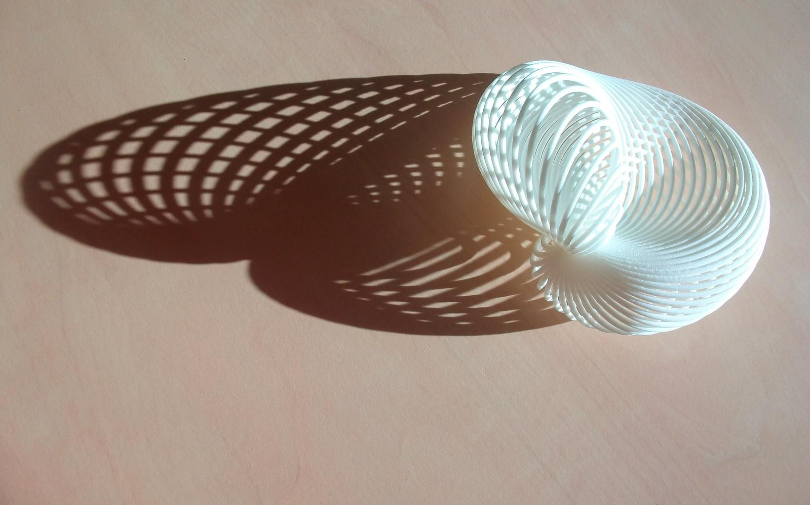
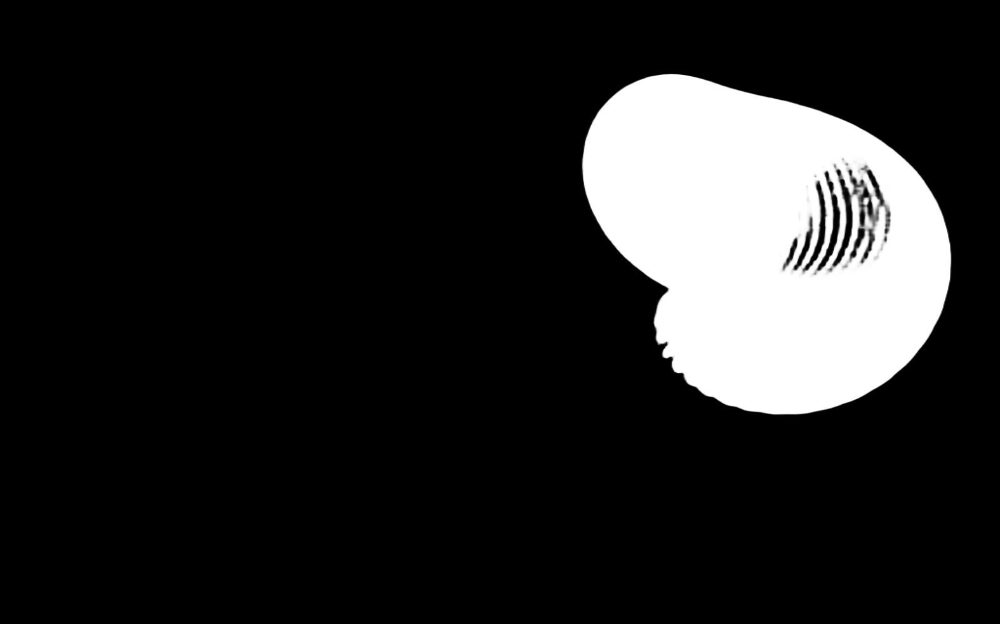
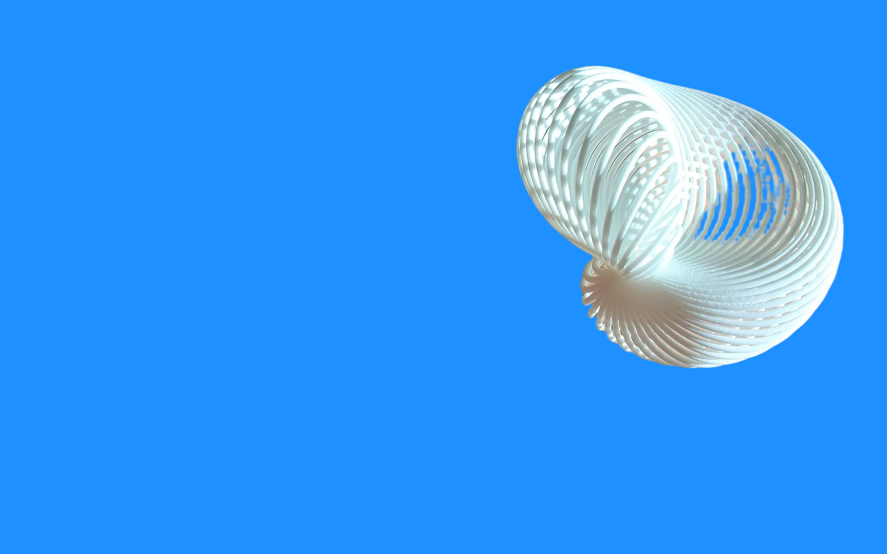
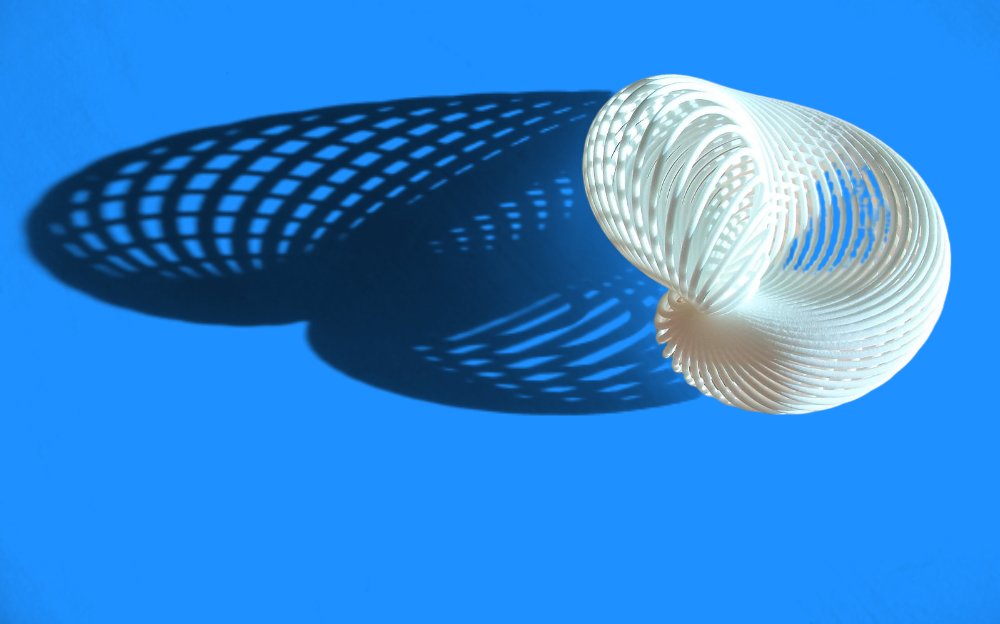

# Background change

Puts the subject of a photo (a person or a product) on a solid colour, optionally keeping its shadows. Pipeline: BiRefNet segmentation → soft alpha + foreground colour estimation → optional shadow map → compositing over the new colour.

Time spent: about 21 hours, per day in [HOURS.md](HOURS.md). Every experiment, failures included: [EXPERIMENTS.md](EXPERIMENTS.md).

## Install and run

```bash
pip install -r requirements.txt
python change_bg.py input.jpg --color "#1E90FF" -o out.png --save-mask
python change_bg.py input.jpg --color "#1E90FF" --keep-shadows --shadow-strength 0.8 -o out.png
```

- `--color` takes 3- or 6-digit hex, with or without `#`.
- `-o` defaults to `<input name>_bg.png` next to the input; `--save-mask` also writes the alpha as `<output name>_mask.png`.
- `--device cpu` or `--device cuda` (default: cuda if available).
- `--edges fg` (default): soft alpha + foreground colour estimation, so the old background does not leak into the hair (E2). `soft` and `hard` are kept for comparison.
- `--keep-shadows` keeps the subject's shadows on the new colour (E3): the new colour is darkened where the photo is darker than its estimated lit background. Off by default, because on a textured background (grass, cobblestones) the texture is kept too. `--shadow-strength` from 0 (no shadow) to 1 (as measured, the default). `--shadow-method inpaint` (default) ignores light falloff on the backdrop but cuts shadows that reach farther than 10 % of the image diagonal from the subject; `flat` keeps long shadows on a plain backdrop but takes light falloff for shadow.
- The first run downloads BiRefNet (444 MB, cached by Hugging Face) and compiles the foreground estimation (numba, cached on disk). On my laptop CPU a ~3 MP photo takes about 40 s.
- Tested with Python 3.13, on Windows (CPU) and on Google Colab (Tesla T4).
- Tests: `pip install pytest`, then `python -m pytest`. The one test that runs the real BiRefNet is skipped unless `BGCHANGE_SLOW=1`.

## Results

Three experiments. Each has its hypotheses written before the run, one run on Google Colab (Tesla T4), and a decision.

| | Question | Compared, on what | Main result | Decision |
|---|---|---|---|---|
| E1 | Which segmentation model? | 7 models¹ on 15 portraits, 20 products and 10 thin or transparent objects (all with ground truth), plus 10 fashion photos judged by eye | BiRefNet and InSPyReNet tie on people + products (IoU 0.959 vs 0.965, p = 0.61). BiRefNet has the lower alpha error on all 15 portraits; InSPyReNet is better on products and thin structures. | **BiRefNet** (MIT licence): 0.4 s per image on the T4 |
| E2 | What to do at the edge of the subject? | hard mask / soft alpha / soft alpha + foreground colour estimation, on the 15 portraits, 30 synthetic images with a known answer and 6 real photos | Foreground estimation removes 14 to 41 % of the colour error in the hair (better in 59 of 60 comparisons). The hard mask is the worst in the hair on all 15 portraits. | **Soft alpha + foreground estimation** (`--edges fg`, the default): adds under 1 s for a 2.6 MP photo on CPU |
| E3 | How to keep the subject's shadows? | no shadow / flat lit background / inpainted lit background / see-through layer, on 225 synthetic images with a known shadow, 34 real shadows (DESOBA) and 9 fashion photos | Inpainted is the best on short shadows (error 0.69 grey levels, 2.95 with no shadow). Flat is the best on long shadows on a plain backdrop (0.78 vs 5.19 for inpainted), but darkens the backdrop wherever the light falls off. | **Inpainted** (`--keep-shadows`): off by default, strength 1; `--shadow-method flat` as an option |

¹ BiRefNet, BiRefNet_lite, BiRefNet-matting, BEN2, InSPyReNet, IS-Net, U²-Net. RMBG-2.0 only by eye, through its public demo: its weights are non-commercial.

- E3 errors: mean absolute difference to the exact answer on the background, in grey levels (0 to 255), with BiRefNet's alpha, on the new colour `#1E90FF`.
- Speed on Colab: BiRefNet 0.4 s per image on the T4; on the CPU, foreground estimation takes 0.36 s per megapixel and the shadow map 0.14 s per image.
- Tables: [results/](results/). Figures (hard cases, zoomed crops): the executed notebooks in [experiments/](experiments/). Test sets (how each is built, sources, licences): [data/e1_subset.md](data/e1_subset.md), [data/e2_subset.md](data/e2_subset.md), [data/e3_subset.md](data/e3_subset.md).

### Examples

`python change_bg.py <image> --color "#1E90FF" --save-mask`, then the same with `--keep-shadows --shadow-method flat`.

| | Original | Mask | No shadow | With shadow (`flat`) |
|---|---|---|---|---|
| Test 1: tennis player |  |  |  |  |
| Test 2: object |  |  |  |  |

## What still fails

- **Hair.** BiRefNet's alpha in the hair is a smooth blur without strands. After foreground estimation, 9.5 to 27 grey levels of error are left in the hair, against about 5.5 with the true alpha: the remaining error comes from the alpha, not from the compositing.
- **Glass and sheer fabric** come out opaque, so the old background stays visible through them (eyeglass lenses, a sheer runway skirt).
- **Long shadows** are cut where they reach farther than 10 % of the image diagonal from the subject, with a visible edge. `--shadow-method flat` keeps them, but only on a plain backdrop.
- **Textured backgrounds.** `--keep-shadows` copies the texture (grass, soil) into the new colour. On DESOBA's real shadows it is not better than no shadow overall (6.71 vs 6.19 grey levels, p = 0.48), although it halves the error inside the shadow. This is why it is off by default.
- **Kept shadows** are a little too light (a 3 % dead zone against noise), shadows fainter than 3 % disappear, the colour of a shadow is lost (one darkening for R, G and B), and the shadows of other objects close to the subject are kept.
- **Products and thin structures.** InSPyReNet is better than BiRefNet there: IoU 0.952 vs 0.939 on products, and better on 9 of the 10 thin structures.
- **Speed on CPU**: about 40 s for a ~3 MP photo on my laptop.
- **The evaluation is small**: 15 portraits from one dataset, 20 products of which one is a garment, one run per experiment, and a colour error in plain RGB, not a perceptual one. DIS-VD is BiRefNet's validation set, so its product scores may be optimistic.

Tried and did not work (details in [EXPERIMENTS.md](EXPERIMENTS.md)): the see-through shadow layer (worse than the inpainted map on all 180 synthetic images with a shadow); a wider inpainting band for long shadows (better on plain backdrops, worse on the gradient backdrop and on DESOBA); RMBG-2.0's free demo quota, which ran out after 3 images.

## Related work

Only what I used, and what I took from it.

- **BiRefNet**: Zheng et al., *Bilateral Reference for High-Resolution Dichotomous Image Segmentation*, CAAI AIR 2024 ([arXiv 2401.03407](https://arxiv.org/abs/2401.03407)). The segmentation model of the pipeline.
- **DIS / IS-Net**: Qin et al., *Highly Accurate Dichotomous Image Segmentation*, ECCV 2022 ([arXiv 2203.03041](https://arxiv.org/abs/2203.03041)). Its DIS-VD set gave the products and thin structures of E1; IS-Net is a baseline.
- **U²-Net**: Qin et al., Pattern Recognition 2020 ([arXiv 2005.09007](https://arxiv.org/abs/2005.09007)). The older baseline.
- **InSPyReNet**: Kim et al., *Revisiting Image Pyramid Structure for High Resolution Salient Object Detection*, ACCV 2022 ([arXiv 2209.09475](https://arxiv.org/abs/2209.09475)). The runner-up of E1.
- **BEN2** ([model card](https://huggingface.co/PramaLLC/BEN2)) and **RMBG-2.0** ([model card](https://huggingface.co/briaai/RMBG-2.0), non-commercial): tested in E1, from their model cards.
- **MODNet**: Ke et al., AAAI 2022 ([arXiv 2011.11961](https://arxiv.org/abs/2011.11961)). Its PPM-100 benchmark gave the portraits and their mattes, the ground truth for people in all three experiments. The model itself was not tested.
- **Foreground estimation**: Germer et al., *Fast Multi-Level Foreground Estimation*, ICPR 2020 ([arXiv 2006.14970](https://arxiv.org/abs/2006.14970)), through `pymatting`. Removes the old background from the edge colours (E2).
- **Compositing**: Porter & Duff, *Compositing Digital Images*, SIGGRAPH 1984. The "over" operator that makes the final image.
- **Shadow model**: Chuang et al., *Shadow Matting and Compositing*, SIGGRAPH 2003. A shadow multiplies the background, so the new colour is multiplied by the ratio of the photo to its lit background (E3). Also why a see-through layer cannot represent a shadow.
- **Inpainting**: Telea, *An Image Inpainting Technique Based on the Fast Marching Method*, Journal of Graphics Tools 2004 (OpenCV's `INPAINT_TELEA`). Fills in the lit background behind the subject and its shadow.
- **DESOBA**: Hong et al., *Shadow Generation for Composite Image in Real-world Scenes*, AAAI 2022 ([arXiv 2104.10338](https://arxiv.org/abs/2104.10338)), built on SOBA (Wang et al., CVPR 2020). Real photos with each shadow removed by hand: real shadows with a known answer.
- **Metrics**: Boundary IoU, Cheng et al., CVPR 2021 ([arXiv 2103.16562](https://arxiv.org/abs/2103.16562)) (E1); gradient error, Rhemann et al., *A Perceptually Motivated Online Benchmark for Image Matting*, CVPR 2009 (E2).

## How I used AI tools

I worked with an AI coding assistant as a pair programmer, from reading the brief to the decisions.

| Step | What the assistant did | What I did |
|---|---|---|
| Understanding the problem | discussed the brief and what makes it hard (hair, glass, white on white, shadows) | chose the questions to study and the time budget |
| Papers | proposed papers related to each question and checked their references online | chose what to read; this README cites what I used |
| Reading | answered my questions while I read (e.g. why compositing the photo itself leaks the old background into the hair) | read the BiRefNet, DIS, Germer et al. and Chuang et al. papers |
| Approaches | suggested options for each experiment (e.g. a flat or an inpainted lit background for shadows) | chose what to compare, on which data, with which metrics |
| Experiment code | wrote most of the code: `bgchange/`, the notebooks, the data scripts, the tests | reviewed it and ran the experiments on Colab |
| Troubleshooting | helped find and work around errors: numpy upgraded mid-session on Colab, ONNX Runtime failing on CUDA, OpenCV 5's inpainting leaving stripes | reproduced each problem and checked the fix |
| Results | discussed the numbers with me (e.g. a paired test when BiRefNet and InSPyReNet were close) | made every decision |

## What I would do next

- **A better alpha in the hair**, where most of the remaining error is (E2): refine BiRefNet's alpha with a matting model such as ViTMatte, with a trimap built from BiRefNet's mask, or run BiRefNet at a higher resolution.
- **Transparency**: matting that handles glass and sheer garments, so the new colour shows through them.
- **Shadows**:
  - a hybrid lit background: flat when the backdrop is plain, inpainted otherwise;
  - a ratio per colour channel, for coloured shadows;
  - instance shadow detection (SOBA, Wang et al., CVPR 2020), to keep only the subject's own shadow on busy backgrounds.
